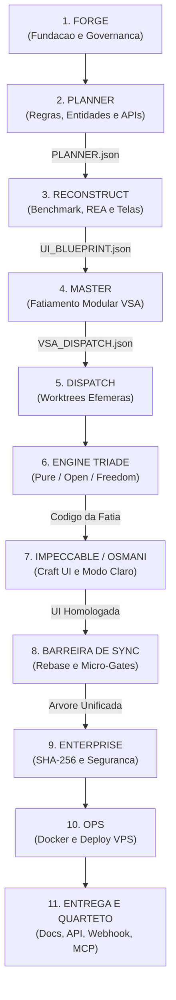

# Ecossistema AIDD Unificado

> **Repositório Central de Engenharia Agêntica de Software (AI-Driven Development)** 
> **GitHub:** `https://github.com/heverton-dev/ecossistema-aidd` 
> **Orquestração:** ORCA ADE (Lead: Antigravity | Governance: Claude Code | Integration: MimoCode)

---

## O que é o Ecossistema AIDD? (Entenda em 1 Minuto)

> **North Star:** Transformar uma ideia em software testado, e distribuir a mesma governança pra qualquer harness de IA.

Imagine uma **fábrica inteligente de automóveis de alta precisão**:
- Você não constrói um carro no improviso: primeiro monta a **linha de produção blindada** para ninguém se machucar, depois a **engenharia desenha e monta o motor**, os **módulos se encaixam como blocos de Lego**, uma **equipe de auditoria certifica cada parafuso** e, por fim, a **equipe de pista abastece e coloca o carro para rodar no asfalto**.

O **Ecossistema AIDD** faz exatamente isso, só que para **Softwares Modernos construídos por Inteligência Artificial**:
ele transforma uma ideia em software testado, aplicando os mesmos Quality Gates e a mesma governança independente de qual assistente de IA está no comando (Claude Code, Cursor, Antigravity, OpenCode, MimoCode etc.).

---

## Escolha seu Estilo de Trabalho (Zero Fricção)

O Ecossistema AIDD foi desenhado para se adaptar ao seu fluxo favorito:

```
┌─────────────────────────────────────────────────────────────────────────────┐
│ 1. DIRETO NO TERMINAL │ 2. 100% NO AGENTE DE IA │ 3. MODO HÍBRIDO │
│ Comandos instantâneos │ Prompts "copia e cola" │ Fábrica completa │
│ via `uvx aidd` (Rust) │ no Claude/Cursor/Agy │ + comandos no chat │
└─────────────────────────────────────────────────────────────────────────────┘
```

---

### Opção 1: Direto no Terminal (Padrão `uvx` — Ultra Rápido)

Com o `uv` (instalador Python moderno escrito em Rust), você cria e roda aplicações em segundos sem configurar ambientes complexos:

```bash
# PURE: Cria aplicação do Zero Puro (TanStack Router + FastAPI + TDD)
uvx aidd pure meu-app

# OPEN: Cria aplicação integrando motores open-source de mercado
uvx aidd open meu-app

# FREEDOM: Liberta app Lovable/Bolt/v0 e converte Supabase para PostgreSQL
uvx aidd freedom https://github.com/usuario/app-lovable.git meu-app
# (ou passando uma pasta local: uvx aidd freedom ./pasta-do-export meu-app)

# FULL: Instala a Fábrica Completa de Governança do Ecossistema
uvx aidd full ecossistema-aidd

# MENU INTERATIVO: Pergunta qual esteira você deseja
uvx aidd
```

> **Dica para desenvolvedores Node.js:** Se preferir usar o ecossistema Node, os comandos também funcionam via NPX: `npx aidd pure meu-app` ou `npx create-aidd-app meu-app`.

---

### Opção 2: 100% com seu Assistente de IA (Prompts "Copia e Cola")

Prefere não digitar nada no terminal e delegar tudo para a Inteligência Artificial? Abra seu assistente (Claude Code, Cursor, Antigravity, OpenCode ou MimoCode) na raiz do ecossistema e use os prompts prontos:

#### Prompt 1: Criar Aplicação do Zero Puro (`/pure`)
```text
Ative o Fluxo 01 (/pure). Quero criar um aplicativo chamado "[NOME_DO_APP]" para [DESCREVA O OBJETIVO DO APP EM UMA FRASE]. Módulos principais: [LISTE 2 OU 3 MÓDULOS, ex: tarefas, clientes, financeiro]. Siga o Padrão-Ouro RevNault (TanStack Router, React 19, FastAPI, SQLite WAL, Modo Claro Soberano e Quarteto Sine Qua Non). Conduza a entrevista de arquitetura e gere o PLANNER.json.
```

#### Prompt 2: Criar Aplicação com Motores Open-Source (`/open`)
```text
Ative o Fluxo 02 (/aidd-open). Preciso de uma aplicação para [DESCREVA O OBJETIVO] integrando motores open-source comprovados com Docker Compose. Selecione as ferramentas adequadas e compile o fatiamento modular VSA.
```

#### Prompt 3: Libertar Projeto Low-Code do Lovable / Bolt (`/freedom`)
```text
Ative o Fluxo 03 (/freedom). Desacople este projeto low-code localizado em "[URL_DO_GIT_OU_PASTA_LOCAL]". Remova o vendor lock-in, converta as migrações do Supabase em PostgreSQL padrão, preserve 100% das telas da interface e empacote para minha VPS própria.
```

#### Prompt 4: Polir e Blindar a Interface (`/impeccable-full`)
```text
Execute /impeccable-full em todas as páginas do frontend. Garanta contraste estrito WCAG AA, Modo Claro como padrão soberano, tipografia fluida, zero emojis soltos e validação de dados com Zod.
```

---

### Opção 3: Modo Híbrido (Instalação Rápida + Operação por Chat)

1. Instale a fábrica completa pelo terminal:
 ```bash
 uvx aidd full ecossistema-aidd
 cd ecossistema-aidd
 ```
2. Abra a pasta no seu assistente de IA.
3. As regras de governança, portões de qualidade (Quality Gates) e habilidades dos agentes se ativam sozinhas na primeira mensagem. Digite comandos como `/pure`, `/open`, `/freedom` ou `/master` diretamente no chat.

---

## Ambiente Python do projeto (`.venv`)

Desde 2026-09-19 o repositório usa um **ambiente Python próprio**, em `.venv/`, em vez de instalar os pacotes no Python geral da máquina. O motivo é concreto: com tudo no mesmo lugar, um pacote impedia o outro — o `checkov` travava o `litellm` numa versão com 7 vulnerabilidades conhecidas — e o que rodava na máquina não era o que os arquivos mandavam instalar.

```bash
# Criar e preencher (uma vez por clone)
python -m venv .venv
.venv/Scripts/python.exe -m pip install --require-hashes -r requirements-dev.lock # Windows
.venv/bin/python -m pip install --require-hashes -r requirements-dev.lock # Linux/macOS

# Dependências específicas de cada ferramenta
.venv/Scripts/python.exe -m pip install -r modulos/02-triade-motores/fluxo-01-pure/core/aidd-pure/requirements.txt
.venv/Scripts/python.exe -m pip install -r modulos/03-plataforma-e-entrega/fatiamento-master/aidd-master/requirements.txt
.venv/Scripts/python.exe -m pip install -r modulos/03-plataforma-e-entrega/blindagem-enterprise/aidd-enterprise/requirements.txt
.venv/Scripts/python.exe -m pip install -r modulos/03-plataforma-e-entrega/operacoes-ops/aidd-ops/requirements.txt
```

`--require-hashes` é obrigatório: ele recusa qualquer pacote cuja assinatura não bata com a registrada no lockfile. Nunca instale a partir de `requirements.txt` direto para trabalhar no repositório — esse arquivo é a **fonte** dos pins, e o lockfile é o que tem as assinaturas.

O `checkov` **não** entra neste ambiente: ele vive no ambiente isolado do hook `g-infra-compose` (ver `.pre-commit-config.yaml`), porque exige uma dependência interna incompatível com o `litellm` corrigido.

---

## Esteira Canônica Calibrada: O Pipeline Oficial de 11 Etapas

A esteira resolve de ponta a ponta a distância entre planejamento de backend, design de interface de alta fidelidade e blindagem de engenharia de software, conforme documentado em `docs/manuais/DISSECACAO-ESTEIRA-11-PASSOS-AIDD.md`:



---

## As 11 Etapas da Esteira: Do Leigo ao PhD

| Etapa | Ferramenta / Motor | O que faz no dia a dia (Leigo) | Rigor Arquitetural (PhD / Arquiteto) | Comando / Atalho |
| :--- | :--- | :--- | :--- | :---: |
| **1. Fundação** | **`aidd-forge`** | Prepara o terreno, coloca cercas de proteção e impede que a IA faça bagunça. | Bootstrap determinístico, git hooks obrigatórios, context-purge e isolamento multi-harness. | `/forge` |
| **2. Planejamento** | **`aidd-planner`** | Conduz a entrevista de arquitetura e desenha o contrato oficial do sistema. | Intake BDD/SDD, modelagem de entidades, regras invariantes e contrato formal `PLANNER.json` com hash SHA-256. | `/planner` |
| **3. Engenharia Reversa** | **`aidd-reconstruct`** | Captura referências visuais e padrões do mundo real para não desenhar telas genéricas. | Extração de design tokens via Mobbin/REA, compilação de jornadas reais e geração do `UI_BLUEPRINT.json`. | `/reconstruct` |
| **4. Fatiamento** | **`aidd-master`** | Divide o sistema em fatias verticais isoladas para serem construídas em paralelo sem conflitos. | Compilação de grafo topológico VSA (Vertical Slice Architecture), unindo endpoints do Planner às telas do Reconstruct. | `/master` |
| **5. Despacho** | **`aidd-dispatch`** | Cria clones rápidos e seguros de trabalho para isolar cada tarefa. | Orquestrador de Git Worktrees efêmeras e paralelas baseadas no DAG de dependências compilado. | `/dispatch` |
| **6. Motores da Tríade** | **`pure` / `open` / `freedom`** | A linha de montagem especializada escolhida para construir ou migrar a aplicação. | Execução de uma das 3 Engines: `aidd-pure` (Zero Puro TDD), `aidd-open` (Motores OSS) ou `aidd-freedom` (Desacoplamento Low-Code). | `/pure`<br>`/open`<br>`/freedom` |
| **7. Craft de Interface** | **`aidd-impeccable-full`** | Audita e refina o visual para entregar padrão de produto profissional de alta qualidade. | Ciclo de 7 passes com princípios do Addy Osmani: Modo Claro Soberano, contraste WCAG AA, validação Zod e zero layout shifts. | `/impeccable-full` |
| **8. Barreira de Sincronia** | **`vsa_join_barrier`** | Testa cada pedaço individualmente e junta tudo na árvore principal com rebase preventivo. | Execução dos Micro-Gates de fatia (< 2s), verificação de stubs (Lei #5) e merge determinístico com rollback em conflito. | `/pipeline` |
| **9. Blindagem** | **`aidd-enterprise`** | Carimba a segurança de ponta a ponta com selo de integridade nível bancário. | Injeção criptográfica SHA-256 de componentes de missão crítica, auditoria de dependências e conformidade Zero-Trust. | `/enterprise` |
| **10. Infraestrutura** | **`aidd-ops`** | Empacota os servidores, ajusta tráfego de rede e prepara o deploy em produção. | Orquestração nativa em Docker Compose, validação de portas, certificados Traefik e provisionamento VPS. | `/ops` |
| **11. Entrega & Quarteto** | **Quarteto Sine Qua Non** | Entrega os 4 estúdios obrigatórios ativos para o usuário e para outros robôs de IA. | Verificação de disponibilidade HTTP 200 nos 4 pilares dinâmicos: OpenAPI (`/api`), Webhook (`/webhook`), MCP (`/mcp`) e Docs (`/docs`). | Lei Inviolável #10 |

---

## A Tríade Canônica: Os 3 Fluxos de Criação Autônoma (Etapa 6)

A única variação entre os projetos gerados pelo ecossistema reside na estratégia do **Motor da Tríade** executado na Etapa 6:

| Fluxo | Nome Canônico | Motor | Slash Command | Comando Terminal (CLI) | Estratégia de Construção |
| :--- | :--- | :--- | :---: | :--- | :--- |
| **Fluxo 01** | **`aidd-pure`** | `aidd-pure` | **`/pure`** | `uvx aidd pure meu-app` | **Do Zero Puro:** Código autoral sob medida, gerado via TDD Red-Green estrito com TanStack Router e FastAPI. |
| **Fluxo 02** | **`aidd-open`** | `aidd-open` | **`/open`** | `uvx aidd open meu-app` | **Motores Open-Source:** Curadoria, integração e fatiamento VSA de bases OSS consolidadas com Compose. |
| **Fluxo 03** | **`aidd-freedom`** | `aidd-freedom` | **`/freedom`** | `uvx aidd freedom <url-ou-pasta> meu-app` | **Desacoplamento Low-Code:** Desmonte de vendor lock-in (Lovable/v0/Bolt), migração para Postgres e preservação pixel-perfect da UI. |

> **Universal Convergence Funnel:** Qualquer que seja o fluxo, a entrega final entrega nativamente o **Quarteto *Sine Qua Non*** (`/api`, `/webhook`, `/mcp`, `/docs`) e o Frontend no **Padrão-Ouro TanStack Router + React 19 + Tailwind CSS** (Lei Inviolável #11). Next.js permanece formalmente abolido por acoplamento proprietário de runtime.

---

## SUPREMACIA AGNÓSTICA — Universalidade Total

O ecossistema segue a **Regra de Ouro da Universalidade**: nada aqui pertence a uma marca, modelo ou fornecedor específico. Você é 100% livre:

1. **Qualquer Sistema Operacional:** Roda igualzinho no Windows, Linux e macOS (100% Python puro).
2. **Qualquer Assistente de IA (Multi-Harness):** Funciona nativamente no **Antigravity (agy), Claude Code, OpenCode, MimoCode, Cursor, Gemini CLI, Hermes e DeepSeek**.
3. **Qualquer Modelo de IA:** Opera usando o próprio assistente da sua sessão (Zero custo adicional de token) ou via provedores externos locais/nuvem (Ollama, Groq, Anthropic, OpenAI).
4. **Escreva Uma Vez, Rode em Todos:** Uma habilidade (skill) ou comando criado é automaticamente distribuído para todos os assistentes em suas respectivas pastas (`.agent/`, `.claude/`, `.gemini/`, `.agents/`).

---

## Como Usar na Prática

Você pode usar o ecossistema de duas formas simples, dependendo de como prefere trabalhar:

### Opção 1: Pelo Chat do seu Assistente (Modo Fácil / Sem Fricção)
Basta digitar os comandos com barra no chat do seu assistente de IA (Claude, Antigravity, Mimo, Cursor):

```bash
# Disparar a Tríade Canônica de Criação:
/pure "Sistema de Gestão de Tarefas" # Fluxo 01: Do Zero Puro via TDD Red-Green
/open "ERP para Clínicas com WhatsApp" # Fluxo 02: Acelerado por Motores Open-Source
/freedom ./meu-export-lovable meu-saas # Fluxo 03: Desacopla Low-Code preservando a UI

# Ferramentas Especialistas e Comandos Rápidos:
/forge . # Blindar um projeto com regras de qualidade
/generate "Ideia de software" # Transformar uma ideia em código funcional
/master produtos # Adicionar uma nova fatia vertical (rotas + banco + tela)
/enterprise skill seguranca-cibernetica # Injetar segurança corporativa certificada SHA-256
/ops plan "Clínica com agendamento" # Dimensionar infraestrutura de servidores e deploy
/factory --plano PLANO.json --pasta ./app # Gerar aplicação completa a partir do plano Ops

# Engenharia Procedimental Anti-Vibe Coding (Skills Universais):
/aidd-grill "Alinhar premissas e invariantes antes de codificar"
/aidd-spec "Gerar especificação técnica formal determinística"
/aidd-tdd "Ciclo Red-Green-Refactor com Zero Stubs"
/aidd-diagnose "Triage científica de falhas via grafo de impacto"
/aidd-handoff "Serializar contexto de sessão para troca de agentes"
```

### Opção 2: Pelo Terminal / Linha de Comando (Modo Engenheiro / CI/CD)
Controle total com determinismo absoluto via `python ecossistema.py`:

```bash
# Execução Síncrona da Tríade Canônica de Ponta a Ponta:
python ecossistema.py run-fluxo --fluxo pure --nome "Tarefas" --slug tarefas --dominio produtividade --pasta ./projetos/tarefas
python ecossistema.py run-fluxo --fluxo open --nome "Clínica" --slug clinica --dominio saude --pasta ./projetos/clinica
python ecossistema.py run-fluxo --fluxo bridge --nome "Hub" --slug hub --dominio saas --pasta ./projetos/hub --origem ./exports/lovable

# Ver a saúde e status de todo o ecossistema
python ecossistema.py status

# Rodar a auditoria geral (Quality Gates Globais)
python ecossistema.py audit

# Testar o deploy de ponta a ponta em modo simulação seguro
python ecossistema.py ops deploy staging --dry-run
```

---

## Os 16 Portões de Segurança (Quality Gates Globais)

Antes de qualquer código ser considerado "pronto", ele é obrigado a passar por **16 testes automáticos e rigorosos** (como o raio-x e a alfândega de um aeroporto):

1. **G_ECOSSISTEMA_INTEGRIDADE:** Garante que todas as pastas, arquivos essenciais e sintaxe Python estão 100% corretos.
2. **G_DRIFT_NUCLEO_COMPARTILHADO:** Compara os códigos compartilhados entre o Master e o Enterprise para impedir divergências acidentais.
3. **G_HARNESS_COMPAT:** Confere se todos os assistentes de IA estão com as ferramentas sincronizadas.
4. **G_SEGREDOS:** Varre todo o código em busca de senhas ou chaves de API acidentalmente esquecidas.
5. **G_CLI_HELP_CONSISTENCIA:** Valida via análise sintática (AST) se as opções explicadas nas mensagens batem exatamente com as flags reais da linha de comando.
6. **G_COMPONENTE_AGNOSTICO:** Audita se novos componentes funcionam de forma universal em qualquer ambiente.
7. **G_ZERO_HEADLESS:** Garante que o desenvolvedor humano esteja sempre no controle, bloqueando robôs ou subagentes ocultos que gastariam tokens em segundo plano.
8. **G_INFRA_COMPOSE:** Audita arquivos Docker Compose delegando ao scanner Checkov e com parsing estruturado PyYAML, garantindo que não existam portas duplicadas, segredos, variáveis faltando ou erros de banco de dados.
9. **G_HADOLINT:** Audita todos os Dockerfiles (existentes e gerados) contra as melhores práticas de segurança e sintaxe OCI, via Hadolint.
10. **G_TESTES_REAIS:** Roda a suíte de testes de verdade (pytest) de cada ferramenta e reprova se qualquer teste falhar — nunca aceita "confia em mim".
11. **G_HONESTIDADE_ROTULO:** Impede que os próprios gates usem termos de marketing exagerados ("blindagem militar" e afins) em vez de descrever a cobertura real comprovada.
12. **G_ARQUITETURA_DELIVERABLE:** Audita, via análise sintática, se o código gerado e os módulos das ferramentas respeitam Clean Architecture/DDD — bloqueia banco de dados fora do lugar certo, dependências erradas e acoplamento direto entre camadas.
13. **G_DEPENDENCIAS_PIN_HASH:** Garante que dependências de terceiros estejam amarradas com hash (pinned) para evitar substituições maliciosas.
14. **G_ESCRITOR_ATOMICO:** Verifica que arquivos são escritos de forma atômica (temporário + rename) para evitar corrupção em caso de falha.
15. **G_TRANSACTION_LOG_LRU:** Valida que logs de transações estão íntegros e não corrompidos, usando estratégias LRU.
16. **G_UNIVERSAL_HARNESS:** Confere compatibilidade real com todos os harnesses de IA suportados.
17. **G_STACK_PADRAO_OURO (Lei #11):** Audita a conformidade da stack soberana: TanStack Start / Router + React + TypeScript + Tailwind CSS (Next.js formalmente abolido), Backend Python e SQLite WAL.
18. **G_TEMPLATE_TANSTACK_OFFLINE:** Valida a integridade do template PWA/Offline-First com casca dupla (Admin/Mobile) e fila criptografada HMAC.
19. **G_NOVE_CAMADAS_MERCADO:** Audita a aderência completa às 9 Camadas Arquiteturais de Mercado (Design Tokens OKLCH, Shells, PWA, Offline HMAC, Cache/Zod, VSA, SQLite WAL, Quarteto Dinâmico e Testes Reais).

> **Validação em um comando:** `python ecossistema.py audit` (Roda os gates em sequência e retorna `exit 0` apenas com 100% de aprovação).

---

## Padrão-Ouro Tecnológico Soberano (Lei #11)

Todo software gerado ou evoluído no ecossistema implementa rigorosamente a **Matriz Tecnológica Soberana 2026** ([MANDATO-TECNOLOGICO-SOBERANO.md](docs/protocolos/MANDATO-TECNOLOGICO-SOBERANO.md)):

* **Frontend Soberano:** **TanStack Start / TanStack Router + React 19 + TypeScript + Tailwind CSS v4** (O framework Next.js foi **formalmente abolido** por acoplamento proprietário de runtime, fragilidade na navegação offline por RSC e carência de type-safety nativa em Search Params).
* **Estética & Acessibilidade:** Design Tokens em formato perceptualmente uniforme **OKLCH**, primitivos acessíveis Radix UI (WCAG 2.2 AA) e princípios da disciplina **Impeccable**.
* **Casca Dupla Adaptativa:** `AdminShell.tsx` (desktop) e `MobileShell.tsx` (mobile-first com navegação inferior e suporte a gestos).
* **PWA & Offline-First:** Service Worker Workbox 7 com autoUpdate, Web App Manifest v2 e fila local FIFO protegida por **assinatura criptográfica HMAC SHA-256** anti-adulteração.
* **Backend & API:** Monólito Modular em Fatias Verticais (**VSA**) com Python puro (Litestar/FastAPI) e contratos dinâmicos em **OpenAPI 3.1**.
* **Persistência Transacional:** SQLite em modo **WAL** (`journal_mode=WAL`, `busy_timeout=5000`) de alta concorrência ou PostgreSQL 16+ com migrações determinísticas reversíveis (Drizzle / Alembic).
* **Quarteto Sine Qua Non Dinâmico (Lei #10):** Toda aplicação nasce nativamente com os 4 estúdios embutidos no layout:
 - OpenAPI Studio (`/api`);
 - Webhook Studio (`/webhook`);
 - MCP Studio (`/mcp`) para consumo seguro por agentes de IA;
 - Central de Documentação e Guia Vivo (`/docs`).

---

## Mapa do Repositório

```text
ecossistema-aidd/
├── AGENTS.md ──► A Lei Fundamental e a governança canônica
├── MEMORY.md ──► A memória viva e o histórico consolidado
├── PLANO-EXECUCAO-ESTRUTURADO.json ──► Telemetria e métricas reais de testes
├── README.md ──► Este portal unificado
├── ecossistema.py ──► A central de comando unificada (CLI)
│
├── componentes/ ──► O cofre canônico de onde nascem todos os componentes
│ ├── compartilhado/ ──► Habilidades e comandos universais
│ └── aidd-master/ ──► Componentes do AIDD Master
│
├── gates/ ──► Os 16 Portões de Segurança determinísticos
│
├── modulos/ ──► As 4 Macro-Camadas VSA e Esteira Canônica de 11 Etapas
│ ├── 01-governanca-e-qualidade/ ──► aidd-forge, aidd-planner, Quality Gates
│ ├── 02-triade-motores/ ──► aidd-pure, aidd-open, aidd-freedom
│ ├── 03-plataforma-e-entrega/ ──► aidd-master, aidd-enterprise, aidd-ops
│ └── 04-nucleo-compartilhado/ ──► Almoxarifado, contratos e invariantes
│
└── docs/ ──► Toda a inteligência documentada
 ├── planos/ ──► Planos táticos e de auditoria
 │ ├── feitos/ ──► Concluídos (status real, não alegado)
 │ ├── fazendo/ ──► Em execução
 │ ├── a-fazer/ ──► Aguardando execução
 │ └── INDEX.md ──► Gerado por scripts/atualizar_index_planos.py — não editar à mão
 ├── protocolos/ ──► Protocolos canônicos de agnosticidade
 ├── relatorios/ ──► Relatórios formais e auditorias
 ├── prompts/ ──► Biblioteca de prompts
 ├── features/ ──► Documentação de features
 ├── explicacoes/ ──► Explicações detalhadas
 ├── melhorias/ ──► Registro de melhorias
 └── testes/ ──► Baterias de testes E2E e relatórios formais
```

---

## Licença

Distribuído sob a licença MIT. Construído para ser livre, universal e soberano.
