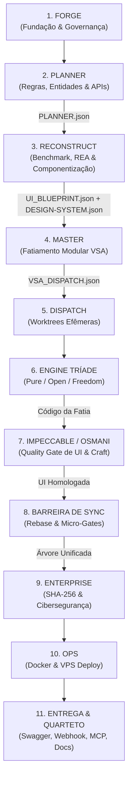
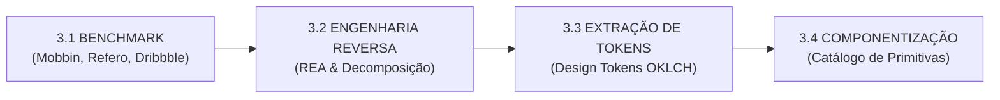

# DISSECAÇÃO CIRÚRGICA DOS 11 PASSOS DA ESTEIRA CANÔNICA AIDD (V2.1 ULTRA-DETALHADA)

> **Documento Oficial de Arquitetura, Governança & Engenharia Agêntica**  
> **Versão:** 2.1 (Dissecação Micro-Fase a Micro-Fase, Handoffs Internos e Padrão Osmani Transversal)  
> **Padrão:** Zero Stubs, Determinismo Estrito, UI de Alta Fidelidade (Mobbin + Refero + Osmani Craft)

---

## 1. VISÃO GERAL DO PIPELINE CANÔNICO DE 11 ETAPAS

A esteira resolve de ponta a ponta a lacuna histórica entre **planejamento de backend**, **design de interface de alta fidelidade** e **blindagem de engenharia de software**.

---

## 2. PRINCÍPIOS TRANSVERSAIS DO ADDY OSMANI (CRAFT & ENGENHARIA DE PRODUTO)

Em vez de ser apenas uma checagem pontual no final, os princípios do Addy Osmani permeiam as 11 etapas:
1. **Performance Budget First (Orçamento de Desempenho):** Toda decisão de biblioteca ou componente é auditada contra peso de bundle e latência de interação (FID/INP, LCP, CLS).
2. **Light Mode Sovereign (Soberania do Modo Claro):** Foco em contraste WCAG 2.2 AA/AAA, superfícies limpas off-white (`#f8fafc`), bordas ardósia de 1px e hierarquia tipográfica densa.
3. **Resilience & Graceful Degradation:** Toda tela deve tratar formalmente 5 estados obrigatórios: *Idle*, *Loading* (skeletons polidos, sem saltos de layout), *Empty* (orientativo com call-to-action), *Error* (recuperável com retry) e *Success*.
4. **Zero Layout Shifts (CLS = 0):** Imagens e componentes de dados reservam espaço intrínseco antes da renderização.

---

## ETAPA 1: FORGE (`aidd-forge`) — FUNDAÇÃO E GOVERNANÇA

### 1.1 Visão Geral
Prepara a infraestrutura agêntica do repositório, garantindo que nenhum código seja escrito sem isolamento de ambiente, git hooks e limites de contexto.

### 1.2 Micro-Fases Internas

#### Micro-Fase 1.1: Instalação de Git Hooks Determinísticos
- **Entrada (Input):** Diretório do repositório alvo.
- **Processamento:** Copia scripts determinísticos de pre-commit e commit-msg para `.git/hooks/`, ativando a verificação de sintaxe (`py_compile`), varredura de stubs (Lei #5) e formato de mensagens.
- **Natureza:** **Determinística** (Script Python / Bash puro).
- **Scripts/Ferramentas:** `modulos/01-governanca-e-qualidade/core/aidd-forge/aidd_forge/core/git_hooks.py`.
- **Handoff Interno:** `.git/hooks/` ativado e executável.
- **Micro-Gate:** Validação de permissões e teste de interceptação sintética.

#### Micro-Fase 1.2: Injeção de Perfis Multi-Harness
- **Entrada (Input):** `.git/hooks/` ativo.
- **Processamento:** Materializa as pastas de configuração para os agentes suportados (`.claude/`, `.gemini/`, `.agents/`, `.cursor/`, `.mimocode/`), garantindo universalidade (Lei #6).
- **Natureza:** **Determinística** (Cópia byte-a-byte de templates do almoxarifado).
- **Scripts/Ferramentas:** `aidd_forge/core/injector_profiles.py`.
- **Handoff Interno:** Estrutura de perfis presente no disco.
- **Micro-Gate:** `G_HARNESS_COMPAT.py`.

#### Micro-Fase 1.3: Injeção de Regras de Economia de Tokens e Governança
- **Entrada (Input):** Perfis injetados.
- **Processamento:** Grava as regras canônicas de contexto (< 2000 tokens), proibição de logs brutos e modo executor silencioso (`AGENTS.md` e regras locais).
- **Natureza:** **Determinística** (Arquivos estáticos selados).
- **Scripts/Ferramentas:** `aidd_forge/core/almoxarifado.py`.
- **Handoff da Etapa:** Repositório 100% configurado e pronto para o Planner.
- **Gates de Saída:** `G_TEMPLATE_FORGE_ROT.py`, `G_aidd_forge.py`, `G_TESTES_REAIS.py`.

---

## ETAPA 2: PLANNER (`aidd-planner`) — ESCOPO E CONTRATOS DE DOMÍNIO

### 2.1 Visão Geral
Recebe a intenção de negócio do usuário e transforma em especificações funcionais e contratos de domínio executáveis com integridade criptográfica SHA-256.

### 2.2 Micro-Fases Internas

#### Micro-Fase 2.1: Entrevista Socrática (`aidd-grill`)
- **Entrada (Input):** Prompt do usuário com ideia ou necessidade de produto.
- **Processamento:** O agente conduz uma entrevista socrática com perguntas numeradas para desmantelar premissas, definir limites e casos de borda.
- **Natureza:** **Probabilística** (Raciocínio semântico de LLM guiado por critérios de negócio).
- **Skills/MCPs:** Skill `aidd-grill`.
- **Handoff Interno:** Decisões de negócio consolidadas e premissas resolvidas.
- **Micro-Gate:** `G_aidd_grill.py` (audita se as respostas cobrem o escopo).

#### Micro-Fase 2.2: Confronto com a Arquitetura (`aidd-grill-docs`)
- **Entrada (Input):** Respostas da entrevista socrática.
- **Processamento:** Consulta o grafo de conhecimento e os padrões arquiteturais (`codebase-memory-mcp`) para garantir que os módulos propostos respeitem os padrões existentes.
- **Natureza:** **Mista** (Busca estruturada no Knowledge Graph + validação LLM).
- **Skills/MCPs:** Skill `aidd-grill-docs`, MCP `codebase-memory-mcp`.
- **Handoff Interno:** Lista de entidades, rotas e regras de negócio alinhadas.

#### Micro-Fase 2.3: Especificação Binária (`aidd-spec`) e Quebra de Tickets (`aidd-tickets`)
- **Entrada (Input):** Arquitetura e regras validadas.
- **Processamento:** Gera a especificação funcional contendo critérios de aceite estritamente binários e quebra o desenvolvimento em tickets tracer-bullet rastreáveis com dependências topológicas (`Blocked by`).
- **Natureza:** **Determinística** (Compilação JSON Schema com validação Pydantic).
- **Scripts/Ferramentas:** `modulos/01-governanca-e-qualidade/core/aidd-planner/src/core_planner/compiler.py`.
- **Handoff da Etapa:** `PLANNER.json` assinado com `payload_sha256`.
- **Gates de Saída:** `G_aidd_plan.py`, `G_aidd_spec.py`, `G_aidd_tickets.py`.

---

## ETAPA 3: RECONSTRUCT (`aidd-reconstruct` / `aidd-cataloger`) — BENCHMARK, REA & COMPONENTIZAÇÃO

### 3.1 Visão Geral
Resolve a "cegueira visual" do ecossistema. Transforma o `PLANNER.json` em um blueprint completo de telas, componentes reutilizáveis e tokens de design antes de qualquer código ser escrito.

### 3.2 Micro-Fases Internas (Sequência Calibrada)

#### Micro-Fase 3.1: Benchmark Visual Multi-Fonte
- **Entrada (Input):** `PLANNER.json` (entidades, personas e casos de uso).
- **Processamento:** Varredura em referências de mercado de alta maturidade para o mesmo domínio:
  - **Mobbin MCP:** User flows completos e jornadas reais em produção.
  - **Fontes Especializadas:** Refero.design, Styles, Behance, Dribbble, Pinterest e Transitions.dev (para padrões de micro-interações).
- **Natureza:** **Mista** (Busca semântica no catálogo MCP + curadoria visual).
- **Skills/MCPs:** `mobbin-mcp` (`mobbin_buscar_telas`), `rea`.
- **Handoff Interno:** Galeria de telas de referência e mapeamento de fluxos de navegação.

#### Micro-Fase 3.2: Engenharia Reversa Visual (REA)
- **Entrada (Input):** Telas de referência selecionadas no benchmark.
- **Processamento:** Decompõe a anatomia das telas: hierarquia de seções, proporções, densidade de informação e arquitetura de componentes pai-filho.
- **Natureza:** **Mista** (Análise estrutural de layout via MCPs visuais).
- **Skills/MCPs:** Skill `reverse-engineer-anything` (REA), `aidd-cataloger`.
- **Handoff Interno:** Árvore estrutural de blocos e layouts decompostos.

#### Micro-Fase 3.3: Extração de Design Tokens
- **Entrada (Input):** Telas decompostas.
- **Processamento:** Extrai as variáveis canônicas de design:
  - Cores: Paleta semântica em formato OKLCH (Soberania do Modo Claro: `#ffffff` e `#f8fafc`, texto em `#0f172a`, bordas em `#e2e8f0`).
  - Tipografia: Escala harmônica (Plus Jakarta Sans / Inter).
  - Raios de borda, sombras de elevação e grid responsivo.
- **Natureza:** **Determinística** (Extração determinística via `mobbin_extrair_tokens` e JSON Schema).
- **Scripts/Ferramentas:** `scripts/extrair_tokens_mobbin.py`.
- **Handoff Interno:** `DESIGN-SYSTEM.json`.

#### Micro-Fase 3.4: Componentização & Catálogo de Primitivas (Anti-Duplicação)
- **Entrada (Input):** Layouts decompostos e `DESIGN-SYSTEM.json`.
- **Processamento:** **Mapeia e cataloga componentes atômicos compartilhados** para impedir que a mesma UI (botão, card, modal, formulário, badge, tabela) seja reescrita múltiplas vezes:
  - Cria o catálogo formal de primitivas reutilizáveis (HTML/React/Tailwind).
  - Especifica os 5 estados do Osmani para cada componente (*idle*, *loading*, *empty*, *error*, *success*).
- **Natureza:** **Determinística** (Compilação estruturada via `mobbin_compilar_design_system`).
- **Handoff da Etapa:** `UI_BLUEPRINT.json` (telas e jornadas de usuário) + `DESIGN-SYSTEM.json` (tokens e componentes catalogados).
- **Gates de Saída:** `G_CRAFT_VISUAL.py`, `G_linter_design.py`.

---

## ETAPA 4: MASTER (`aidd-master`) — MONÓLITO MODULAR VSA

### 4.1 Visão Geral
Une as APIs e modelos de dados do Planner às telas e componentes do Reconstruct, organizando o projeto na arquitetura de fatias verticais (Vertical Slice Architecture).

### 4.2 Micro-Fases Internas

#### Micro-Fase 4.1: Mapeamento de Fatias Verticais de Domínio
- **Entrada (Input):** `PLANNER.json` + `UI_BLUEPRINT.json`.
- **Processamento:** Associa cada rota da API e entidade de banco à sua respectiva tela no frontend, agrupando em módulos verticais autônomos (`src/modules/<modulo>/`).
- **Natureza:** **Determinística** (Script Python de fatiamento arquitetural).
- **Scripts/Ferramentas:** `modulos/03-plataforma-e-entrega/fatiamento-master/aidd-master/scripts/add_module.py`.
- **Handoff Interno:** Estrutura de pastas modular gerada.

#### Micro-Fase 4.2: Acoplamento da Infraestrutura Transversal
- **Entrada (Input):** Módulos mapeados.
- **Processamento:** Conecta o barramento transversal compartilhado: EventBus, Outbox assíncrono, SQLite WAL e Row Level Security (RLS) para isolamento por tenant.
- **Natureza:** **Determinística** (Injeção de templates de infraestrutura do almoxarifado).
- **Scripts/Ferramentas:** `modulos/03-plataforma-e-entrega/fatiamento-master/aidd-master/scripts/scaffold_infra.py`.
- **Handoff da Etapa:** `VSA_DISPATCH.json` (DAG com dependências entre fatias e fronteiras de arquivos).
- **Gates de Saída:** `G_MODULO_FRONTEIRA.py`, `G_COPIA_UNICA_VSA.py`, `G_DRIFT_NUCLEO_COMPARTILHADO.py`.

---

## ETAPA 5: DISPATCH (`aidd-dispatch`) — WORKTREES ISOLADAS

### 5.1 Visão Geral
Executa a orquestração do trabalho em paralelo, isolando cada fatia vertical em branches e pastas efêmeras do Git para garantir desenvolvimento sem colisões.

### 5.2 Micro-Fases Internas

#### Micro-Fase 5.1: Ordenação Topológica do Grafo (Kahn DAG)
- **Entrada (Input):** `VSA_DISPATCH.json`.
- **Processamento:** Calcula a ordem exata de execução das fatias que não possuem dependências bloqueantes.
- **Natureza:** **Determinística** (Algoritmo determinístico de grafos DAG).
- **Scripts/Ferramentas:** `modulos/03-plataforma-e-entrega/fatiamento-master/aidd-master/scripts/dispatch_pipeline.py`.
- **Handoff Interno:** Lotes sequenciais/paralelos de execução.

#### Micro-Fase 5.2: Criação de Git Worktrees Efêmeras
- **Entrada (Input):** Lotes topológicos.
- **Processamento:** Dispara `git worktree add .worktrees/vsa_<fatia>` com branches isoladas e injeta micro-gates locais.
- **Natureza:** **Determinística** (Comandos Git).
- **Handoff da Etapa:** Worktrees ativas prontas para receber o motor.
- **Gates de Saída:** `G_DISPATCH_PIPELINE_VSA.py`, `G_MICRO_GATES_DIFF.py`.

---

## ETAPA 6: MOTORES DA TRÍADE (`pure` | `open` | `freedom`) — IMPLEMENTAÇÃO REAL

### 6.1 Visão Geral
Executa dentro de cada worktree individual. Constrói o código real de backend e frontend da fatia sem stubs nem mocks, orientado a testes reais.

### 6.2 Micro-Fases Internas (Fluxo 01 Pure como Piloto)

#### Micro-Fase 6.1: TDD Red-Green Estrito
- **Entrada (Input):** Contratos de API da fatia vindos do Planner.
- **Processamento:** Escreve os testes unitários e de integração (`test_*.py`), roda a suíte (falha esperada - RED), implementa a rota/serviço e roda novamente até aprovar (GREEN).
- **Natureza:** **Determinística** (Execução pytest estrita).
- **Skills/MCPs:** Skill `aidd-tdd`.
- **Handoff Interno:** Backend da fatia implementado e testado.

#### Micro-Fase 6.2: Implementação do Frontend Conectado
- **Entrada (Input):** `UI_BLUEPRINT.json` da fatia e catálogo de componentes.
- **Processamento:** Codifica as páginas em React 19 + TanStack Router + Tailwind CSS, consumindo a API real via TanStack Query (`useQuery`, `useMutation`), aplicando os componentes pré-catalogados na Etapa 3.
- **Natureza:** **Mista** (Geração agêntica guiada pelo blueprint visual).
- **Skills/MCPs:** Skill `aidd-pure`, `aidd-frontend-forms`.
- **Handoff da Etapa:** Código completo da fatia (backend + frontend).
- **Gates de Saída:** `G_STACK_PADRAO_OURO.py`, `G_NOVE_CAMADAS_MERCADO.py`, `G_TESTES_REAIS.py`.

---

## ETAPA 7: IMPECCABLE / OSMANI — O QUALITY GATE VISUAL E DE CRAFT

### 7.1 Visão Geral
Atua como o filtro de qualidade estética e funcional de interface. Se a tela gerada pelo motor parecer um MVP feio ou amador, **a esteira reprova imediatamente antes do merge**.

### 7.2 Micro-Fases Internas (Ciclo Impeccable)

#### Micro-Fase 7.1: Auditoria Visual e de Acessibilidade (WCAG 2.2)
- **Entrada (Input):** Frontend construído pelo motor.
- **Processamento:** Inspeciona as telas via navegador headless ou Chrome DevTools MCP: valida contraste de cores em Modo Claro, foco em teclado, semântica HTML e responsividade (mobile, tablet, desktop).
- **Natureza:** **Determinística** (Auditoria Lighthouse e cálculo de contraste CSS).
- **Skills/MCPs:** `chrome-devtools-mcp`, `playwright`, `aidd-linter-design`.
- **Handoff Interno:** Laudo de auditoria visual com pontuação de conformidade.

#### Micro-Fase 7.2: Refino de Formulários e Micro-Interações (Osmani Polish)
- **Entrada (Input):** Telas auditadas.
- **Processamento:** Blindagem de formulários com Zod (mensagens de erro claras em PT-BR), feedback visual durante requisições e transições sutis sem layout shifts (CLS = 0).
- **Natureza:** **Mista** (Ajuste de código CSS/TypeScript guiado pelas regras de craft).
- **Skills/MCPs:** Skill `aidd-frontend-forms`, `impeccable-full`.
- **Handoff da Etapa:** Interface homologada com padrão de produto final.
- **Gates de Saída:** `G_CRAFT_VISUAL.py`, `G_UI_API_PARITY.py`.

---

## ETAPA 8: BARREIRA DE SINCRONIZAÇÃO (`vsa_join_barrier`) — CONVERGÊNCIA SEGURA

### 8.1 Visão Geral
Consolida o trabalho das diferentes worktrees em uma única árvore íntegra sem quebrar o código existente.

### 8.2 Micro-Fases Internas

#### Micro-Fase 8.1: Rebase Preventivo e Micro-Gates de Fatia
- **Entrada (Input):** Worktree finalizada com a fatia aprovada pelo Impeccable.
- **Processamento:** Atualiza a branch da worktree contra a branch principal (`git rebase`), executa os micro-gates (`py_compile`, stubs, testes unitários). Em caso de conflito, aborta e gera rollback report.
- **Natureza:** **Determinística** (Git rebase determinístico).
- **Scripts/Ferramentas:** `modulos/03-plataforma-e-entrega/fatiamento-master/aidd-master/scripts/vsa_join_barrier.py`.
- **Handoff Interno:** Branch rebaseada e testada.

#### Micro-Fase 8.2: Merge e Limpeza de Worktrees
- **Entrada (Input):** Micro-gates aprovados (exit 0).
- **Processamento:** Realiza o merge na branch principal e remove a pasta `.worktrees/vsa_*` do disco.
- **Natureza:** **Determinística** (Comandos Git).
- **Handoff da Etapa:** Repositório principal com todas as fatias unificadas.
- **Gates de Saída:** `G_PIPELINE_HANDOFF.py`, `G_ESCRITOR_ATOMICO.py`, `G_TRANSACTION_LOG_LRU.py`.

---

## ETAPA 9: ENTERPRISE (`aidd-enterprise`) — BLINDAGEM SHA-256 E CIBERSEGURANÇA

### 9.1 Visão Geral
Protege a aplicação consolidada contra vazamentos, vulnerabilidades conhecidas e adulterações de dependências.

### 9.2 Micro-Fases Internas

#### Micro-Fase 9.1: Varredura de Cibersegurança (OWASP Top 10)
- **Entrada (Input):** Árvore unificada pós-barreira.
- **Processamento:** Analisador estático busca brechas de SQL injection, XSS, execução remota de código e segredos commitados (`.secrets.baseline`).
- **Natureza:** **Determinística** (AST + regex de segurança).
- **Scripts/Ferramentas:** `gates/G_CYBERSECURITY_OWASP.py`, `gates/G_BLOQUEAR_SEGREDOS.py`.
- **Handoff Interno:** Relatório de vulnerabilidades limpo (0 issues).

#### Micro-Fase 9.2: Selagem Criptográfica SHA-256 de Peças e Contratos
- **Entrada (Input):** Repositório aprovado na segurança.
- **Processamento:** Calcula e carimba os hashes SHA-256 de todos os arquivos de almoxarifado no `CATALOGO.json` e nos contratos de handoff.
- **Natureza:** **Determinística** (Funções de hash hashlib sha256).
- **Scripts/Ferramentas:** `aidd-enterprise/application_enterprise/pecas_catalogo.py`.
- **Handoff da Etapa:** Aplicação blindada e auditada com selos íntegros.
- **Gates de Saída:** `G_aidd_enterprise.py`, `G_DEPENDENCIAS_PIN_HASH.py`, `G_SUPPLY_CHAIN.py`.

---

## ETAPA 10: OPS (`aidd-ops`) — INFRAESTRUTURA E DEPLOY

### 10.1 Visão Geral
Gera os artefatos de infraestrutura como código (IaC) e prepara o deploy automatizado para servidores de nuvem (VPS).

### 10.2 Micro-Fases Internas

#### Micro-Fase 10.1: Geração de Containers Multi-Stage (Docker Compose)
- **Entrada (Input):** Repositório blindado pela Enterprise.
- **Processamento:** Gera `Dockerfile` multi-stage otimizado (isolando compilação do runtime) e `docker-compose.yml` com limites de memória e reinicialização automática.
- **Natureza:** **Determinística** (Templates Jinja do almoxarifado).
- **Scripts/Ferramentas:** `modulos/03-plataforma-e-entrega/operacoes-ops/aidd-ops/scripts/compose_suite.py`.
- **Handoff Interno:** Arquivos de container gerados.

#### Micro-Fase 10.2: Verificação de Portas e Infraestrutura
- **Entrada (Input):** Arquivos Docker gerados.
- **Processamento:** Valida sintaxe com Hadolint e assegura que nenhuma porta arbitrária além das autorizadas (3000 e 5173/80/443) seja exposta.
- **Natureza:** **Determinística** (Linter e checagem de portas).
- **Handoff da Etapa:** Pacote de deploy pronto para produção.
- **Gates de Saída:** `G_INFRA_COMPOSE.py`, `G_HADOLINT.py`.

---

## ETAPA 11: ENTREGA & QUARTETO SINE QUA NON DINÂMICO

### 11.1 Visão Geral
Sobe a aplicação localmente para o usuário com validação de saúde (HTTP 200) e entrega os 4 estúdios obrigatórios ativos em Modo Claro corporativo.

### 11.2 Micro-Fases Internas

#### Micro-Fase 11.1: Inicialização e Verificação de Saúde (Healthcheck)
- **Entrada (Input):** Aplicação pronta e configurada.
- **Processamento:** Sobe o backend e frontend e realiza probe HTTP determinístico nas rotas vitais (`/docs`, `/api/health`, `/`).
- **Natureza:** **Determinística** (Requisições HTTP reais).
- **Handoff Interno:** Status code 200 confirmado nos dois serviços.

#### Micro-Fase 11.2: Entrega dos 4 Estúdios do Quarteto Dinâmico
- **Entrada (Input):** Servidores ativos.
- **Processamento:** Disponibiliza as URLs operacionais em Modo Claro corporativo:
  - **OpenAPI / Swagger Studio:** `/docs` (documentação viva das APIs de todos os módulos).
  - **Webhook Studio:** `/webhook` (simulador de eventos e webhooks ativos).
  - **MCP Native Studio:** `/mcp` (ferramentas e recursos expostos para agentes IA).
  - **Central de Documentação / Guia:** `/docs/guia` (documentação enciclopédica do sistema com Mermaid).
- **Natureza:** **Determinística** (Templates estáticos renderizados com dados dinâmicos).
- **Handoff da Etapa:** URLs ativas e operacionais.

#### Micro-Fase 11.3: Emissão do Resumo ao Usuário (Rule 10)
- **Entrada (Input):** URLs ativas e logs de execução.
- **Processamento:** Emite o relatório executivo transparente em linguagem simples e direta estruturado em 3 blocos (`A. O que já foi feito`, `B. O que precisa fazer`, `C. Sugestão de próximo passo`).
- **Natureza:** **Determinística** (Geração de markdown baseada em dados factuais).
- **Handoff Final:** `RESUMO-USUARIO.md` gravado e turno encerrado com sucesso.
- **Gates de Saída:** `G_QUARTETO_SINE_QUA_NON.py`, `G_CONTRACT_ROT.py`, `G_RESUMO_USUARIO.py`, `G_SAIDA_BINARIA.py`.
